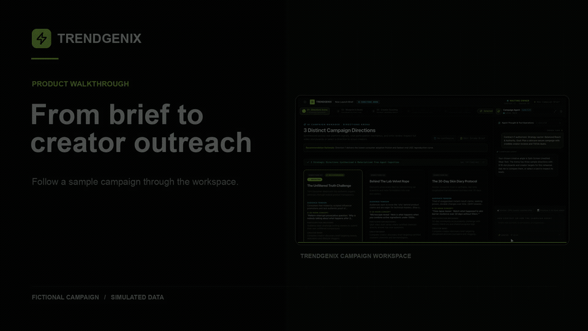

# Trendgenix

An agentic workspace for campaign creation, influencer discovery and deal preparation, and creative analysis.

Watch the full-resolution 59-second video

https://github.com/user-attachments/assets/4ce2838d-41b5-499b-9495-2ae991604b07

The walkthrough uses a fictional campaign with illustrative creators, rates, and performance data.

## Agentic architecture

A persistent manager agent coordinates campaign work through model-selected tools, on-demand skills, and specialist agents for research, critique, and revision. OpenAI's Responses API provides reasoning and schema-validated outputs that feed an interactive agent chat and campaign canvas.

Cloudflare's Agents SDK, Durable Objects, and Workflows support stateful conversations and resumable execution. D1 stores campaign memory, source evidence, decisions, and checkpoints. Research and generation run within explicit usage budgets, with human approval for campaign decisions and external actions.

The TypeScript workspace uses Next.js and React, with a real-time agent interface for comparing directions, exploring storyboards, reviewing creators, and refining drafts.

## Try it on one campaign

**Pro pilot.** Bring a short, anonymized brief. We’ll look at how your team chooses a direction, evaluates creator fit, and approves a draft pitch. [Request a Pro pilot](https://github.com/TrendgenixHQ/trendgenix-showcase/issues/new?template=pro-pilot.yml)

**Custom build.** Tell us which part of your creator or agency workflow you want to improve and what a useful result would look like. [Discuss a custom build](https://github.com/TrendgenixHQ/trendgenix-showcase/issues/new?template=custom-build.yml)

GitHub inquiries are public. Share a general description of the work and keep client details, account information, and credentials private.
