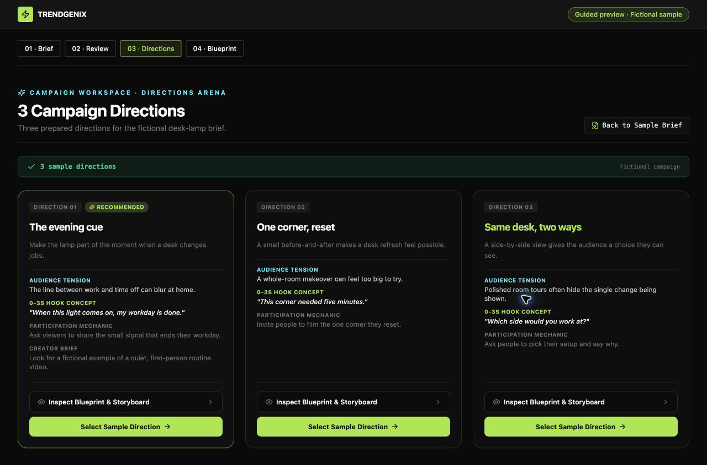

# Trendgenix

Go from a campaign brief to creative directions and short-video storyboards your team can review together.

[Watch the 45-second walkthrough](media/trendgenix-walkthrough.mp4) · [Register Pro interest](https://github.com/TrendgenixHQ/trendgenix-showcase/issues/new?title=Trendgenix%20Pro%20interest&body=Tell%20us%20which%20campaign%20planning%20step%20you%20would%20like%20help%20with.%20Please%20share%20only%20information%20you%20are%20comfortable%20making%20public.) · [Discuss a custom project](https://github.com/TrendgenixHQ/trendgenix-showcase/issues/new?title=Custom%20workflow%20inquiry&body=Briefly%20describe%20the%20workflow%20you%20would%20like%20to%20improve%20and%20what%20a%20useful%20outcome%20would%20look%20like.%20Please%20keep%20confidential%20details%20out%20of%20this%20public%20issue.)

## Follow one campaign

Start with a fictional desk-lamp brief, review the creative decision, and compare three directions. Open a Blueprint to inspect the opening shot, spoken script, and sound across three storyboard beats.

The walkthrough uses a prepared fictional example and is available without an account.

## Work with us

**Pro pilots.** Tell us which part of campaign planning you want to improve. We’re interested in hearing from marketers, agencies, and product teams.

**Custom projects.** We build tailored agent workflows for teams that need research, drafts, and human approval in one workspace. Share a brief, public description of the problem you want to solve.
